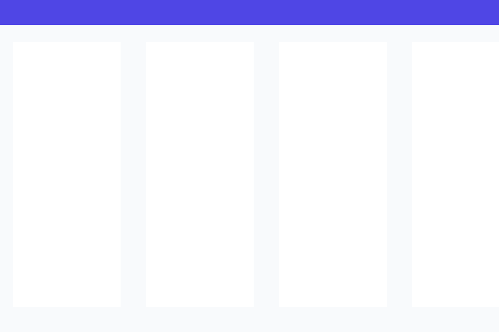
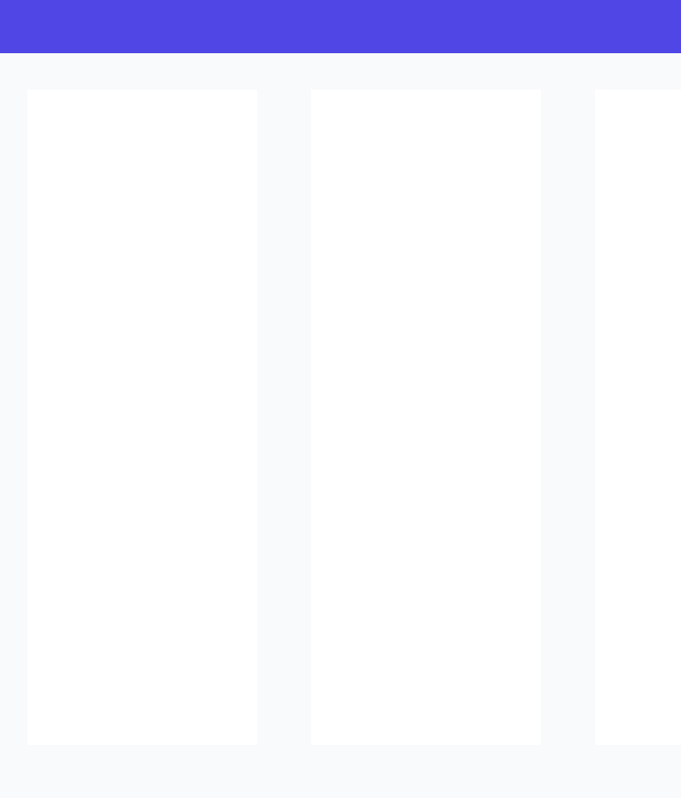
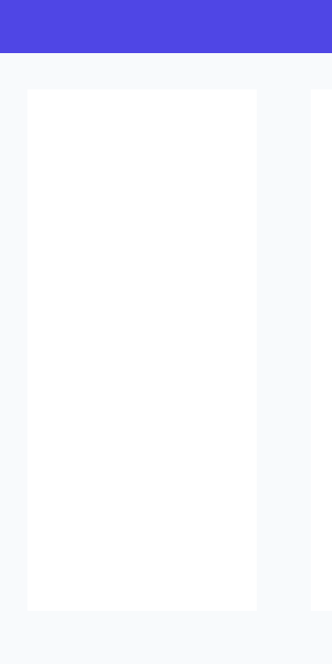

# InternHub — Discover Your Next Opportunity

> A modern, responsive internship listing website designed to help students and early-career talent discover, filter, and track technical internships across top industry domains.

InternHub is engineered with **pure semantic HTML5, modern CSS3, and vanilla JavaScript (ES6+)** with zero dependencies, build tools, or frontend frameworks. It is accessible (WCAG 2.2 AA compliant), mobile-first, lightweight, and ready for instant deployment on GitHub Pages or by opening `index.html` directly in any web browser.

---

## 1. Live Preview

- **Live Demo (GitHub Pages Placeholder):** [https://tariksk786.github.io/InternHub/](https://tariksk786.github.io/InternHub/)
- **Live Preview URL:** (https://tariksk786.github.io/InternHub/)

---

## 2. Key Features

- **Dynamic DOM Rendering:** 16 detailed, realistic sample internship cards generated dynamically via JavaScript `createElement()` and safe `textContent` sanitization to protect against XSS.
- **Instant Keyword Search:** Real-time search by internship title, company name, domain, and specific technical skills (e.g., *Python*, *Figma*, *AWS*, *React*) with immediate clear search button (`✕`) and enter-key submission.
- **Multi-Factor Domain & Work Mode Filtering:**
  - **Domains Covered (8 Core Fields):**
    1. Web Development
    2. Data Science
    3. Artificial Intelligence
    4. Machine Learning
    5. UI/UX Design
    6. Cybersecurity
    7. Cloud Computing
    8. Digital Marketing
  - **Work Modes:** Remote, Hybrid, and On-site.
  - **Dynamic Results Counter:** Real-time updates with ARIA live announcements.
- **Sorting Engine:** Sort opportunities by Newest Posted, Highest Stipend, or Shortest Duration.
- **Bookmarks & Saved Internships:** Save favorite internships to `localStorage` with resilient error handling for private browsing sessions. Filter saved listings with a single click.
- **Native Accessible Dialog Modal (`<dialog>`):**
  - Displays complete role descriptions, responsibilities, qualifications, and benefits.
  - Contextual application button: links to verified portals when available, or displays `"Demo listing — application unavailable."` for mock records.
  - Keyboard focus trapping, Escape-to-close, and focus restoration to the triggering button.
- **Error & Empty State Resilience:**
  - Clear empty state when no listings match search criteria, equipped with a working **Reset Filters** button.
  - Dedicated error state with a working **Try Again** retry action. Includes an optional developer test button in the toolbar to simulate and verify recovery.
- **Light / Dark Theme Toggle:** Persisted in `localStorage` with automated system `prefers-color-scheme` detection.
- **Performance & Zero Bloat:** Pure vanilla implementation without heavy bundles. Instant load times.

---

## 3. Technology Stack

- **HTML5:** Semantic architecture (`<header>`, `<nav>`, `<main>`, `<section>`, `<article>`, `<footer>`, `<dialog>`, `<aside>`).
- **CSS3:**
  - CSS Custom Properties (Design tokens for indigo `#4F46E5`, sky blue `#0EA5E9`, slate `#0F172A`).
  - Flexbox and CSS Grid for equal-height cards and responsive layouts.
  - Background radial gradients and accents.
  - Dark mode theming via `[data-theme="dark"]`.
  - Media queries for 320px, 375px, 640px, 768px, 1024px, and 1440px viewport widths.
  - `@media (prefers-reduced-motion: reduce)` accessibility overrides.
- **Vanilla JavaScript (ES6+):**
  - Strict modular execution with zero external frameworks or libraries.
  - Safe DOM creation APIs (`document.createElement`, `textContent`, `setAttribute`).
  - Native Event Delegation, `localStorage` persistence, and WAI-ARIA live region updates.

---

## 4. Screenshots & Visual Previews

### Desktop View (1024px+)
Three-column responsive card grid, prominent hero banner, and multi-factor filter toolbar:



### Tablet View (640px – 1023px)
Balanced two-column grid with touch-friendly controls:



### Mobile View (Below 640px)
Single-column layout with collapsible navigation drawer and full-width search input:



> **Screenshot Capture Instructions:**
> 1. Open `index.html` in your browser.
> 2. Press `F12` to open Developer Tools and toggle the Device Toolbar (`Ctrl+Shift+M` or `Cmd+Shift+M`).
> 3. Select **Desktop (1440x900)**, **Tablet (iPad 768x1024)**, and **Mobile (iPhone 375x812)**.
> 4. Use the DevTools menu (*Run command* -> *Capture full size screenshot*) and save the images inside `screenshots/desktop.png`, `screenshots/tablet.png`, and `screenshots/mobile.png`.

---

## 5. Accessibility Features (WCAG 2.2 AA)

InternHub is engineered with inclusivity as a foundational pillar:

1. **Semantic Heading Hierarchy:** Exactly one main `<h1>` ("Find Your Dream Internship.") followed by logical `<h2>` sections and `<h3>` card titles.
2. **Keyboard Navigation:** Every interactive element (buttons, links, inputs, selects, dialogs) can be navigated using `Tab`, `Shift + Tab`, `Enter`, and `Space`.
3. **High-Contrast Visible Focus:** Custom `:focus-visible` outline rings (`3px solid var(--primary-color)`) with a 3px offset.
4. **Skip to Main Content Link:** Provides keyboard and screen-reader users with an immediate jump link (`#main-content`) that appears on initial `Tab`.
5. **Screen Reader Announcements:** An `aria-live="polite"` region dynamically announces search filter changes (e.g. *"Showing 4 internships. Filtered by: domain Web Development"*).
6. **Form Accessibility:** All search fields and dropdown selects possess permanently associated visible labels or accessible names.
7. **Accessible Dialog Trapping:** The native HTML5 `<dialog>` prevents background interaction while open, closes on `Escape` or backdrop click, and restores focus to the triggering button.
8. **Motion Safety:** Respects users who prefer reduced motion by disabling animations via `prefers-reduced-motion`.

---

## 6. Project Structure

```text
internhub/
├── index.html              # Semantic HTML5 entry point and dialog modals
├── css/
│   └── style.css           # Pure CSS3 styles, design tokens, and media queries
├── js/
│   ├── data.js             # 16 sample internship objects across 8 domains
│   └── app.js              # Vanilla ES6+ search, filtering, bookmarks, and modal logic
├── screenshots/
│   ├── desktop.png         # Desktop viewport preview
│   ├── tablet.png          # Tablet viewport preview
│   └── mobile.png          # Mobile viewport preview
├── README.md               # Complete project documentation and guide
└── .gitignore              # Standard ignore configuration
```

---

## 7. Local Setup Instructions

No Node.js, npm, or build step is required! You can run InternHub in seconds:

### Method 1: Direct File Opening (Easiest)
1. Download or clone this repository to your local machine.
2. Locate `index.html` in your file explorer.
3. Double-click `index.html` to open it in your browser (Chrome, Edge, Firefox, Safari).

### Method 2: Local HTTP Server (Optional)
If you prefer running a local development server:
```bash
# Using Python 3
python3 -m http.server 8000

# Using Node.js (npx)
npx serve .
```
Navigate to `http://localhost:8000` in your web browser.

---

## 8. GitHub Pages Deployment Instructions

Deploy InternHub to free GitHub Pages hosting in under two minutes:

1. Create a new public repository on GitHub named `responsive-internship-board`.
2. Push or upload all project files (`index.html`, `css/`, `js/`, `screenshots/`, `README.md`) to the root of your repository.
3. On GitHub, navigate to **Settings** > **Pages** (under Code and automation in the sidebar).
4. Under **Build and deployment** > **Source**, choose **Deploy from a branch**.
5. Select branch `main` (or `master`) and folder `/(root)`.
6. Click **Save**.
7. Wait approximately 1–2 minutes for the deployment to finish.
8. Your website will be live at `https://<your-username>.github.io/responsive-internship-board/`.

---

## 9. Comprehensive Testing Checklist

| Test Item | Expected Result | Status |
| :--- | :--- | :---: |
| **Initial Card Rendering** | All 16 sample cards render with title, company, stipend, duration, mode, skills | Passed |
| **Title Search** | Searching "Frontend" filters cards instantly to matching titles | Passed |
| **Company Search** | Searching "Nexus" filters cards to Nexus Interactive | Passed |
| **Skill Search** | Searching "Python" or "Figma" filters cards by required technical skill | Passed |
| **Clear Search** | Clicking the `✕` button clears search input and resets active search query | Passed |
| **Domain Dropdown** | Selecting "Cybersecurity" displays only cybersecurity listings | Passed |
| **Simultaneous Filtering** | Combining keyword "Cloud" with domain "Cloud Computing" works harmoniously | Passed |
| **Reset Filters Button** | Resets domain, mode, keyword, and sort filters back to initial state | Passed |
| **Empty State Display** | Searching a non-existent term shows "No internships found. Try another keyword or domain." | Passed |
| **Empty State Reset** | Clicking "Reset Filters" from empty state restores all cards | Passed |
| **Error State Display** | Clicking "Test Error State" displays error box with "Something went wrong while loading internships." | Passed |
| **Error Recovery** | Clicking "Try Again" recovers the state and re-renders all cards | Passed |
| **Details Modal Open** | Clicking "View Details" opens accessible native `<dialog>` | Passed |
| **Escape Key Closes Modal** | Pressing `Esc` closes the modal and returns focus to the button | Passed |
| **Backdrop Click Closes Modal** | Clicking outside the modal closes it | Passed |
| **Demo Application Link** | Listings without verified application URLs show "Demo listing — application unavailable." | Passed |
| **Bookmarks / Saved Items** | Bookmarks persist across page refreshes using `localStorage` | Passed |
| **Saved Filter Toggle** | Clicking "Saved" in header isolates bookmarked opportunities | Passed |
| **Light / Dark Mode** | Theme toggle switches color palette smoothly and persists selection | Passed |
| **Responsive Grid (320px–1440px)** | 1 col on mobile, 2 col on tablet, 3 col on desktop; zero horizontal overflow | Passed |
| **Keyboard Accessibility** | Full navigation functional via `Tab`, `Shift+Tab`, `Enter`, and `Space` | Passed |

---

## 10. Demo Data Disclaimer

> **Educational Portfolio Notice:**
> The internship listings presented on InternHub are sample demonstrations created exclusively for educational, UI/UX evaluation, and portfolio purposes. Company names, job descriptions, and compensation figures represent realistic simulated data and should not be misconstrued as verified, live job vacancies.
